# Poly Haven: Nature models

**29 assets from [Poly Haven](https://polyhaven.com), dedicated to the public domain under [CC0](https://polyhaven.com/license).** Use them in any game, free or paid, and change them however you like; no credit is needed.

3D models as glTF at 1K and 2K texture resolution, each folder self-contained (`.gltf`, `.bin`, `textures/`). 714.4 MB in all.

This is a copy kept by [zuujis-cc0](https://github.com/zuujis-cc0) so game makers can take single files from GitHub. It is not made by or affiliated with Poly Haven: the originals, often in more formats and higher resolutions, are on [polyhaven.com](https://polyhaven.com). If they help you, consider [supporting Poly Haven](https://www.patreon.com/polyhaven/overview).

Every file is listed in [MANIFEST.tsv](MANIFEST.tsv) with its size and SHA-256. More free assets: [the Zuujis collection](https://github.com/zuujis-cc0/free-game-assets#readme).

| | | | |
| :-: | :-: | :-: | :-: |
| <a href="potted_plant_01">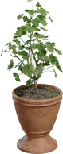</a> <b><a href="potted_plant_01">Potted Plant 01</a></b> by Rico Cilliers · <a href="https://polyhaven.com/a/potted_plant_01">source</a> |  <b><a href="potted_plant_02">Potted Plant 02</a></b> by Rico Cilliers · <a href="https://polyhaven.com/a/potted_plant_02">source</a> | <a href="potted_plant_04">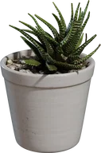</a> <b><a href="potted_plant_04">Potted Plant 04</a></b> by James Ray Cock · <a href="https://polyhaven.com/a/potted_plant_04">source</a> | <a href="quiver_tree_01">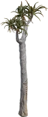</a> <b><a href="quiver_tree_01">Quiver Tree 01</a></b> by Dario Barresi, James Ray Cock, Rico Cilliers · <a href="https://polyhaven.com/a/quiver_tree_01">source</a> |
| <a href="quiver_tree_02">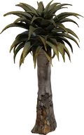</a> <b><a href="quiver_tree_02">Quiver Tree 02</a></b> by Dario Barresi, Rico Cilliers · <a href="https://polyhaven.com/a/quiver_tree_02">source</a> | <a href="rock_07">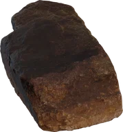</a> <b><a href="rock_07">Rock 07</a></b> by Jenelle van Heerden · <a href="https://polyhaven.com/a/rock_07">source</a> | <a href="rock_09">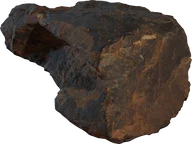</a> <b><a href="rock_09">Rock 09</a></b> by Jenelle van Heerden · <a href="https://polyhaven.com/a/rock_09">source</a> | <a href="rock_face_01">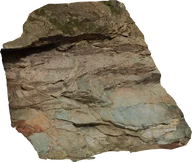</a> <b><a href="rock_face_01">Rock Face 01</a></b> by Dario Barresi · <a href="https://polyhaven.com/a/rock_face_01">source</a> |
| <a href="rock_face_02">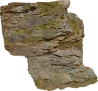</a> <b><a href="rock_face_02">Rock Face 02</a></b> by Dario Barresi, Rico Cilliers · <a href="https://polyhaven.com/a/rock_face_02">source</a> | <a href="rock_moss_set_01">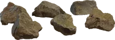</a> <b><a href="rock_moss_set_01">Rock Moss Set 01</a></b> by Kless Gyzen · <a href="https://polyhaven.com/a/rock_moss_set_01">source</a> | <a href="rock_moss_set_02">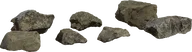</a> <b><a href="rock_moss_set_02">Rock Moss Set 02</a></b> by Kless Gyzen · <a href="https://polyhaven.com/a/rock_moss_set_02">source</a> | <a href="root_cluster_01">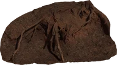</a> <b><a href="root_cluster_01">Root Cluster 01</a></b> by Jenelle van Heerden, Rico Cilliers · <a href="https://polyhaven.com/a/root_cluster_01">source</a> |
| <a href="root_cluster_02">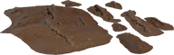</a> <b><a href="root_cluster_02">Root Cluster 02</a></b> by Jenelle van Heerden · <a href="https://polyhaven.com/a/root_cluster_02">source</a> | <a href="sand_rocks_small_01">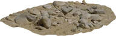</a> <b><a href="sand_rocks_small_01">Sand Rocks Small 01</a></b> by Rico Cilliers, Rob Tuytel · <a href="https://polyhaven.com/a/sand_rocks_small_01">source</a> | <a href="searsia_burchellii">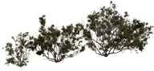</a> <b><a href="searsia_burchellii">Searsia Burchellii</a></b> by James Ray Cock, Jenelle van Heerden · <a href="https://polyhaven.com/a/searsia_burchellii">source</a> | <a href="searsia_lucida">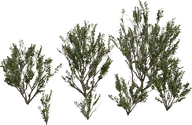</a> <b><a href="searsia_lucida">Searsia Lucida</a></b> by James Ray Cock, Jenelle van Heerden · <a href="https://polyhaven.com/a/searsia_lucida">source</a> |
| <a href="shrub_01">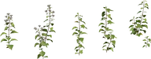</a> <b><a href="shrub_01">Shrub 01</a></b> by Rico Cilliers · <a href="https://polyhaven.com/a/shrub_01">source</a> | <a href="shrub_02">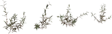</a> <b><a href="shrub_02">Shrub 02</a></b> by Rico Cilliers · <a href="https://polyhaven.com/a/shrub_02">source</a> | <a href="shrub_03">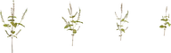</a> <b><a href="shrub_03">Shrub 03</a></b> by Rico Cilliers · <a href="https://polyhaven.com/a/shrub_03">source</a> | <a href="shrub_04">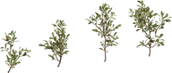</a> <b><a href="shrub_04">Shrub 04</a></b> by Rico Cilliers · <a href="https://polyhaven.com/a/shrub_04">source</a> |
| <a href="shrub_sorrel_01">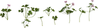</a> <b><a href="shrub_sorrel_01">Shrub Sorrel 01</a></b> by Rico Cilliers · <a href="https://polyhaven.com/a/shrub_sorrel_01">source</a> | <a href="single_root">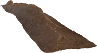</a> <b><a href="single_root">Single Root</a></b> by Jenelle van Heerden · <a href="https://polyhaven.com/a/single_root">source</a> | <a href="stone_01">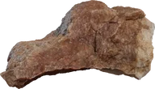</a> <b><a href="stone_01">Stone 01</a></b> by Dario Barresi, Rico Cilliers · <a href="https://polyhaven.com/a/stone_01">source</a> |  <b><a href="street_rat">Street Rat</a></b> by Sean Buckley · <a href="https://polyhaven.com/a/street_rat">source</a> |
| <a href="tree_small_02">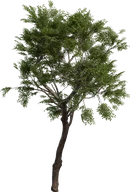</a> <b><a href="tree_small_02">Tree Small 02</a></b> by Rico Cilliers · <a href="https://polyhaven.com/a/tree_small_02">source</a> | <a href="tree_stump_01">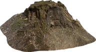</a> <b><a href="tree_stump_01">Tree Stump 01</a></b> by Rob Tuytel · <a href="https://polyhaven.com/a/tree_stump_01">source</a> | <a href="tree_stump_02">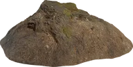</a> <b><a href="tree_stump_02">Tree Stump 02</a></b> by Rob Tuytel · <a href="https://polyhaven.com/a/tree_stump_02">source</a> | <a href="weed_plant_02">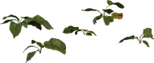</a> <b><a href="weed_plant_02">Weed Plant 02</a></b> by Rico Cilliers, Rob Tuytel · <a href="https://polyhaven.com/a/weed_plant_02">source</a> |
| <a href="wild_rooibos_bush">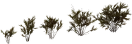</a> <b><a href="wild_rooibos_bush">Wild Rooibos Bush</a></b> by James Ray Cock, Jenelle van Heerden · <a href="https://polyhaven.com/a/wild_rooibos_bush">source</a> |  |  |  |

---

Kept up to date by this repository's own [update workflow](.github/workflows/update.yml), with code and plan from [cc0-mirror](https://github.com/zuujis-cc0/cc0-mirror). Something wrong? [Open an issue there](https://github.com/zuujis-cc0/cc0-mirror/issues/new) or use the [private report form](https://games.zuujis.com/report).
